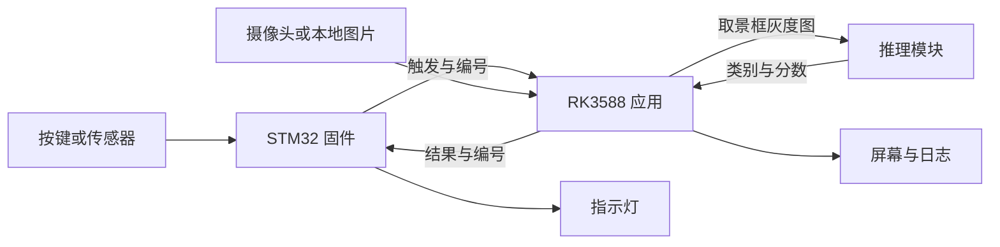

# 课程实验设计报告

《微型计算机系统设计》小组实验 · 选题讨论稿 · 2026-11-25

## 1. 候选题目与现有基础

**候选题目《基于 RK3588 与 STM32 的桌面物品识别与联动系统》**

在桌面上划定一个取景框。STM32 收到按键或到位传感器事件后，通知 RK3588 采集一帧并识别杯子、瓶子或空工位。RK3588 显示类别并把结果回传给 STM32，由指示灯反馈。小组可以现场演示物品放置、识别和反馈的过程，同时展示同一个模型的官方 RKNN 部署与自研卷积后端验证。

- **Conv＋MaxPool 基线**已用官方 RKNN Runtime 在 RK3588 上运行。`rknn_run` 平均耗时约 `0.04 ms`，运行库版本为 `2.5.0`，NPU 驱动版本为 `0.9.0`。[基线与复现步骤](../edge/rk3588/README.md)
- **三分类 CNN**已用合成灰度图跑通电脑端前向和 ONNX 导出验证。接下来准备数据、训练权重并做实拍评估。[模型定义与本地检查](../edge/rk3588/workstation/README.md)
- **组会需要确认**候选题目、任务认领、STM32 型号、传感器清单、摄像头来源、课程提交时间和现场验收要求。

## 2. 功能需求与验证

| 需求 | 实现内容 | 验证方式 |
| --- | --- | --- |
| 触发采集 | STM32 检测一次按键或传感器事件，通知 RK3588 取一帧。应用也能从本地读图，便于独立开发。 | 按一次键产生一条请求，应用日志记录输入来源和事件编号。 |
| 三类识别 | 用带标签的图片在电脑上从头训练小 CNN。杯子、瓶子可从 COCO 按标注框选图，空工位自行拍摄。 | 用独立场景的实拍照片评估三个类别，逐类记录样本数、正确数和错例。 |
| 板载 NPU 推理 | 在电脑上将训练后的模型导出 ONNX，经 RKNN Toolkit2 编译为 `.rknn`，在 RK3588 上运行。 | 对同一批图核对电脑与板端的类别和分数，记录运行库、驱动版本和推理耗时。 |
| 回传与反馈 | RK3588 回传编号和类别。STM32 匹配本次请求，更新指示灯。采集失败或超时有错误提示，并恢复等待。 | 用杯子、瓶子和空工位各演示一次，再模拟一次超时并确认下次能正常触发。 |
| 编译验证 | 将同一份 ONNX 导入 TPU-MLIR 的 TOP 层，从 `top.Conv` 开始实现面向 RK3588 的 lowering 和代码生成。 | 用相同权重和输入对比卷积输出，记录 IR、驱动接口和板端测试结果。 |

训练集的图片来源和划分方式应记录下来。用不同背景或取景位置拍摄实测样本，检查换场地后的识别效果。[COCO 2017 数据下载](https://cocodataset.org/#download)

## 3. 系统模块与接口



### STM32 与 RK3588

两端先核对串口引脚、电平、共地和波特率。首版串口用换行分隔消息，下面是一次编号为 `42` 的请求及其两种回包示例。

```text
TRIGGER,42
RESULT,42,cup
ERROR,42,CAPTURE
```

STM32 每次等待一个请求的结果，只处理编号匹配的回包。建议用常亮表示杯子、慢闪表示瓶子、熄灭表示空工位、快闪表示错误。正式联调前用串口工具模拟回包，先确认超时后的恢复行为。

### 图像应用与推理

应用把取景框裁剪、灰度化并缩放到 `64×64`，转成像素值在 `[0, 1]` 内的 `float32`。建议用 `predict(image)` 作为调用入口，返回类别和三个分数，分数顺序固定为 `empty`、`bottle`、`cup`。推理模块负责按后端要求组织张量。训练、验证和板端应用使用同样的灰度化与缩放规则。

应用可以先接一个返回固定类别的模拟函数，跑通读图、串口回传和状态显示。等真实模型可用后，以相同的输入和输出接口接入。

### RK3588 编译与部署

应用联调先用官方 RKNN 路径，交付训练权重、ONNX 导出命令、RKNN 转换和板端运行记录。自研后端先核对现有驱动接口，再验证一个固定形状的 `top.Conv`。先对比输出形状和数值，再用相同输入、精度、NPU 核配置和计时范围测耗时。后端进度以可复现的 IR、代码和板端日志为准。

## 4. 分工与首个交付

| 负责人 | 计划目录 | 现在能做的第一项 | 交付与自测 |
| --- | --- | --- | --- |
| Sasara | `edge/rk3588/workstation/` 与编译脚本 | 准备三类小样本，在电脑上完成一次训练和导出。 | 按说明复现训练与转换，交付板端 RKNN 日志；推进 TOP 导入和卷积 lowering。 |
| 固件组员（待认领） | `firmware/stm32/` | 确认开发板和串口，按键触发一条消息，用串口工具回包控制 LED。 | 提交可构建的固件、接线和烧录步骤，验证传感器触发、编号匹配和超时。 |
| 应用组员（待认领） | `edge/rk3588/app/` | 用本地图片和固定推理结果贯通读图、取景框预处理和回包。 | 提交应用入口和启动命令，接入摄像头与真实推理，记录类别、耗时和异常。 |
| 全组 | `docs/` | 确认题目、器材、接口、负责人和板卡联调时间。 | 共用一份接线与联调说明，保存验收日志和展示步骤。 |

## 5. GitHub 协作约定

1. 将已验证、可供队友联调的代码通过 PR 合并到 **`main`**。首个 PR 可以从现有 `sasara` 分支提交 RKNN 基线、模型和本报告。[GitHub Flow](https://docs.github.com/zh/get-started/using-github/github-flow)
2. 从最新 `main` **按任务开分支**，例如 `feat/stm32-trigger`、`feat/camera-app` 或 `feat/rk3588-conv-lowering`。完成可自测的一小块，就提交、推送并开 PR，例如提交标题 `feat: 接入 STM32 按键触发`。
3. **请一位队友审核 PR**。写明模块、运行命令和验证结果，涉及接口时同步更新说明和消息示例。需要板卡才能复现的改动附上接线和串口日志。
4. 下一项任务从更新后的 `main` 开工。已有任务分支在提交当前改动后同步主线。出现冲突时由涉及模块的成员核对共同接口和运行命令。
5. 源码、配置、导出命令和说明进 Git。数据集、虚拟环境和生成产物放在已忽略的 `local/`。共享板端模型时注明对应 Git 提交、模型版本与工具链版本。

```bash
# 从最新 main 开一个任务分支
git switch main
git pull --ff-only origin main
git switch -c feat/stm32-trigger

# 自测并提交后，推送分支，在 GitHub 开 PR 到 main
git push -u origin feat/stm32-trigger

# 任务开发期间，工作区干净时把最新 main 合入当前分支
git fetch origin && git merge origin/main
```

## 6. 联调顺序与验收材料

1. 组会**确定题目和负责人**，登记传感器、摄像头、下载器和串口工具，确认串口与推理接口。
2. **各自完成模块自测**。固件用模拟回包控制 LED，应用用本地图片和模拟推理发回结果，模型在电脑上训练、导出和转换。
3. **用本地图片联调双板**，贯通 STM32 触发、RK3588 板载推理、STM32 反馈，再接摄像头和确认可用的传感器。STM32 用同一计时器记录从发出触发到指示灯更新的时间，RK3588 记录推理耗时。
4. **整理演示和复现材料**，包括接线、启动和恢复步骤，以及三类识别、超时恢复、实拍验证、RKNN 基线和自研卷积验证的记录。标明用于复现的提交版本。
